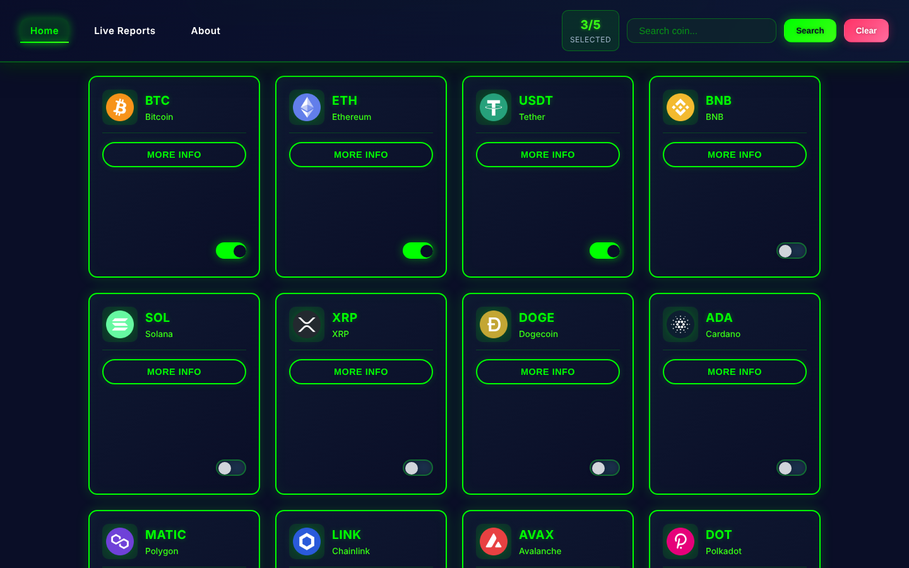

# Cryptonite – Crypto Tracker

A single-page crypto tracker in plain JavaScript: browse coins, see prices in several currencies, pick up to 5 coins and follow them on a live chart.



*Screenshot taken with a saved market snapshot; the live app loads current prices from CoinGecko.*

**Live demo:** https://yuvaldromi1.github.io/cryptonite/

## Features

- Coin list with search, loaded from the CoinGecko REST API
- "More info" per coin: price in USD, EUR and ILS
- Watchlist of up to 5 coins, saved in `localStorage`
- Live report page: prices of the selected coins on a chart (Chart.js), updated every 15 seconds
- Retry with back-off when the API rate limit is reached

## Tech Stack

HTML5 · CSS3 · JavaScript (ES modules) · Fetch API · Chart.js · CoinGecko API

The code is split into modules by responsibility: `api.js` (HTTP), `storage.js` (localStorage), `domUtils.js` (rendering), `events.js` (event handlers), `main.js` and `reports.js` (page logic), `constants.js` (configuration).

## Run Locally

No build step. Serve the folder with any static server, for example:

```bash
npx serve .
```

Then open `/HTML/index.html`. (Opening the file directly does not work, because browsers block ES modules on `file://`.)

## Author

Yuval Dromi · [GitHub](https://github.com/yuvaldromi1)
